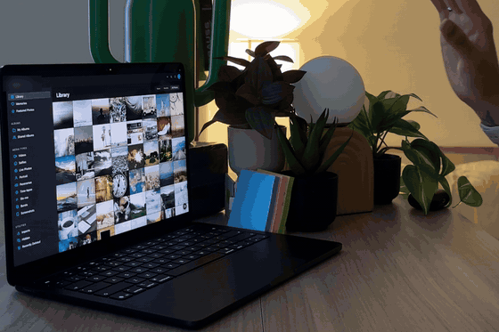

# Gesture Gallery

Control a photo gallery with hand gestures — no mouse, no touch, no headset. Just your webcam and a browser tab.

Recorded on an earlier build. The live version uses free-licence photos from Unsplash (via Lorem Picsum); if they can't load, tiles fall back to generated colours so the demo still works offline.

Move your open palm to glide a cursor over photos, pinch to grab one and pull your hand back to enlarge it, point and tap to select, and make a fist to scroll. Everything runs locally in your browser using your webcam; the camera feed never leaves your device.

> **Live demo:** [divyrajauria.github.io/gesture-photo-gallery](https://divyrajauria.github.io/gesture-photo-gallery/) — open in desktop Chrome or Edge and allow camera access.

## Gestures

| Pose | Motion | What it does |
|------|--------|--------------|
| ✋ Open palm | Move your hand | Cursor follows; the photo under it gets a white border |
| 🤏 Pinch (thumb + index) | From an open palm | Grab the photo under the cursor |
| 🤏 Pinch, then pull back | Move your hand away from the camera | The grabbed photo scales up and follows your hand; release the pinch to spring it back |
| 👆 Point (index out) | Dip the fingertip briefly | Select / deselect the photo under the cursor (blue checkmark), or press the button under it (Remove, Undo…) |
| ✊ Fist | Move your hand up / down | Grab-and-drag scroll through the grid |

## No camera? Keyboard and mouse

Every gesture has a keyboard and mouse equivalent, and the gallery is usable from the first second — before hand tracking has loaded, or if camera access is denied. A small card in the corner says what's happening (loading, camera blocked, no camera found, camera in use by another app) and how to fix it.

| Gesture | Keyboard | Mouse |
|---------|----------|-------|
| Move open palm | Arrow keys (Tab or any arrow key to start) | Hover |
| Point + tap to select | Space | Click |
| Pinch + pull to enlarge | Enter (Esc closes) | Double-click (click outside closes) |
| Fist scroll | Page Up / Page Down, Home / End | Scroll wheel |
| — | Delete removes selected photos; Ctrl/Cmd+Z undoes | **Remove** / **Undo** buttons |

With photos selected, a **Remove** and **Clear** bar appears next to the "N Selected" title; an **Undo** toast follows a removal. Nothing is really deleted — a reload brings every photo back. With the camera on, point-and-tap presses these buttons too: a tap works on any button under the cursor, not just photos.

Esc with nothing enlarged clears the selection. Selection changes and previews are announced to screen readers, and `prefers-reduced-motion` removes decorative animation.

## Run it locally

This is a single, self-contained HTML file — no build step, no dependencies to install.

1. Download or clone this repository.
2. Open `index.html` in **Google Chrome** or **Microsoft Edge** (desktop).
3. Allow camera access when prompted.
4. Raise one hand in view of your webcam and start gesturing. The on-screen guide (ⓘ button, bottom-right) lists every gesture.

**Tip:** browsers only grant camera access on secure origins. Opening the file directly (`file://`) works in Chrome/Edge; if your browser blocks the camera, serve it locally instead, e.g. `python3 -m http.server` and visit `http://localhost:8000`.

## How it works

- **Hand tracking:** [MediaPipe Hands](https://developers.google.com/mediapipe) (loaded from a CDN) detects 21 hand landmarks per frame.
- **Cursor smoothing:** a One-Euro filter keeps the cursor steady at rest and snappy in motion.
- **Photo tiles:** free-licence photos from [Unsplash](https://unsplash.com) via [Lorem Picsum](https://picsum.photos), a fixed photo per tile. A generated gradient sits underneath as a placeholder and as the fallback when offline.
- **Stack:** vanilla HTML, CSS, and JavaScript in one file. No framework, no build.

Key tuning constants live near the top of the `<script>` in `index.html` (sensitivity for pinch, scroll, tap, and cursor smoothing) if you want to adjust the feel.

## Requirements

- A webcam for hand gestures (optional — keyboard and mouse work without one)
- Desktop Chrome or Edge (other Chromium browsers generally work; mobile and Safari are not officially supported)

## License

[MIT](LICENSE) © 2026 Divyanshi Rajauria

---

_Designed and built by Divyanshi Rajauria, with AI assistance._

_Independent educational demo. Not affiliated with, endorsed by, or connected to Apple Inc. or iCloud._
